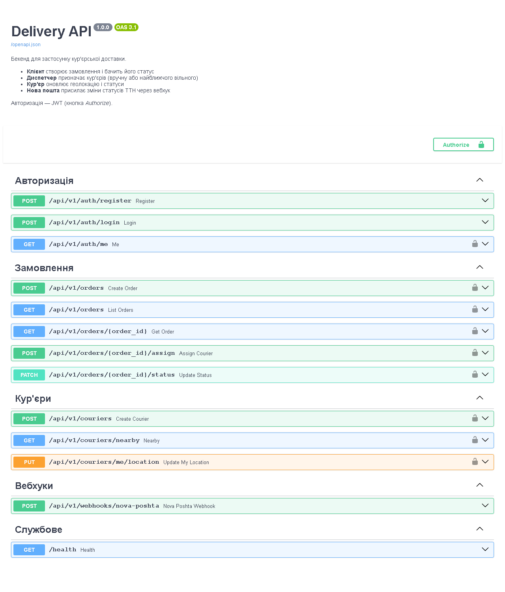

# Delivery API

REST API для мобільного застосунку кур'єрської доставки.



## Можливості

- **Замовлення** — створення з автоматичним розрахунком ціни (відстань + вага), список з фільтром і пагінацією, деталі з історією статусів
- **Статуси** — дозволені переходи описані в одному місці (`ALLOWED_TRANSITIONS`), тому «доставити» скасоване замовлення не вийде; кожна зміна пишеться в історію
- **Пошук кур'єрів** — вільні кур'єри онлайн у радіусі від точки, найближчі першими. На PostgreSQL рахується через PostGIS (`ST_DWithin`, `ST_Distance`), на SQLite — haversine в Python
- **Автопризначення** — диспетчер може не вказувати кур'єра, API підбере найближчого вільного і порахує ETA
- **Вебхук Нової пошти** — статуси ТТН приходять з HMAC-підписом і переводять замовлення в «в дорозі» / «доставлено» / «скасовано»
- **Авторизація** — JWT, ролі `admin`, `dispatcher`, `courier`, `client`; клієнт бачить лише свої замовлення, кур'єр — лише призначені
- **Rate limiting** — ліміт запитів на IP за хвилину; з Redis лічильник спільний для всіх воркерів, без Redis — у пам'яті
- **Фонові задачі (Celery)** — сповіщення про зміну статусу, періодичний перерахунок ETA (Celery beat)
- **Документація** — OpenAPI / Swagger на `/docs`
- **Тести і CI** — pytest + ruff у GitHub Actions, збірка Docker-образу на `main`

## Стек

Python 3.12, FastAPI, SQLAlchemy 2, PostgreSQL + PostGIS, Celery, Redis, Docker.

## Запуск через Docker

```bash
cp .env.example .env
docker compose up --build
```

API: http://localhost:8000/docs

## Локально без Docker

За замовчуванням використовується SQLite, Celery виконує задачі одразу (без воркера):

```bash
python -m venv .venv
.venv/bin/pip install -r requirements-dev.txt
uvicorn app.main:app --reload
```

## Тести

```bash
pytest -q
```

Перевіряють реєстрацію і вхід, доступ до чужих замовлень, сортування кур'єрів за відстанню та виключення зайнятих, повний цикл статусів, вебхук НП з підписом, rate limit.

## Структура

```
app/
  main.py          — застосунок, підключення роутерів і middleware
  models.py        — таблиці та дозволені переходи статусів
  schemas.py       — Pydantic-схеми запитів і відповідей
  security.py      — паролі, JWT, перевірка ролей
  geo.py           — відстані, пошук кур'єрів (PostGIS / haversine), ETA, ціна
  rate_limit.py    — обмеження частоти запитів
  tasks.py         — задачі Celery
  routers/         — auth, orders, couriers, webhooks
tests/
```
